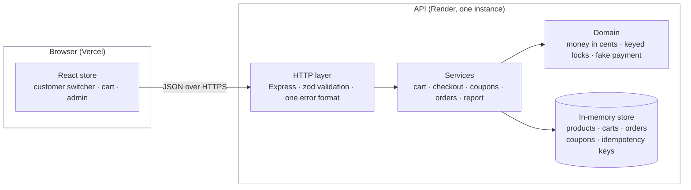
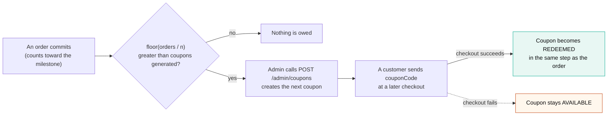
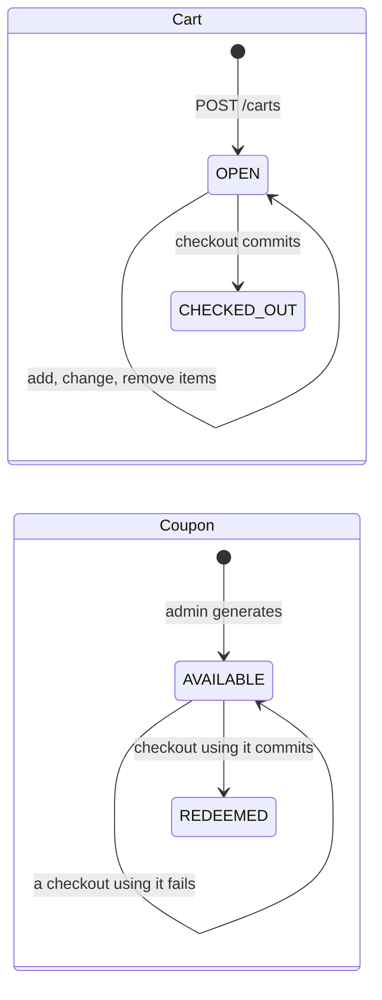
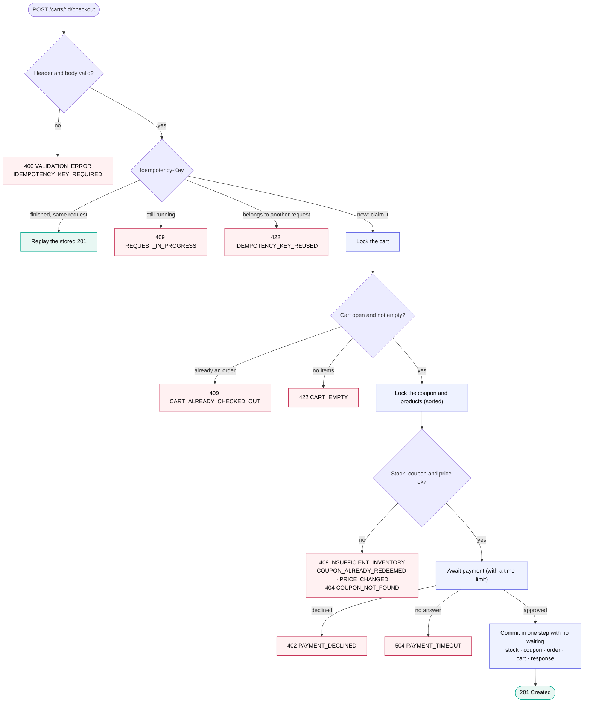
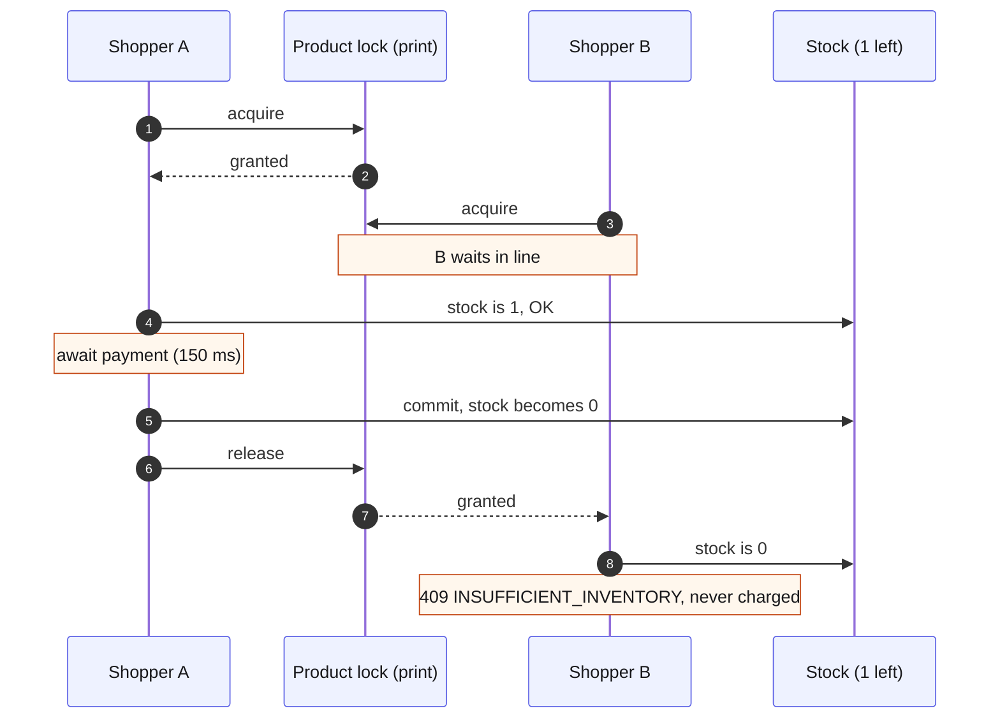
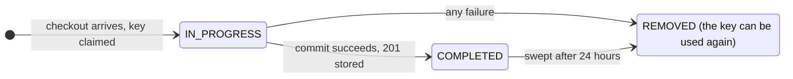
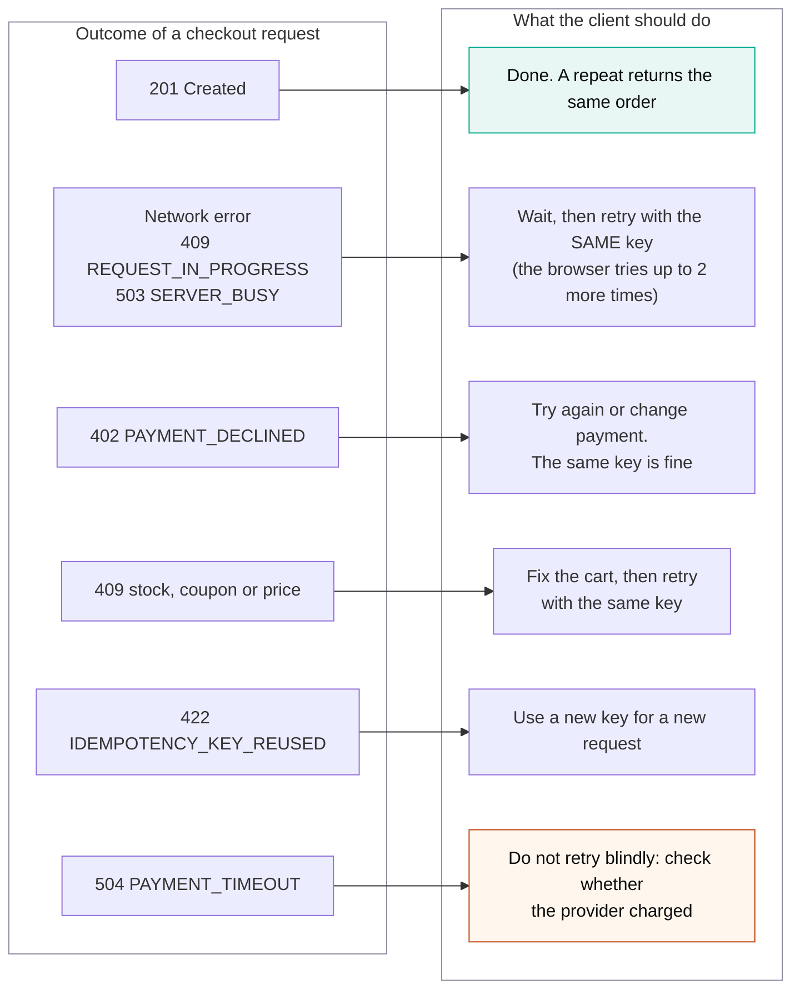
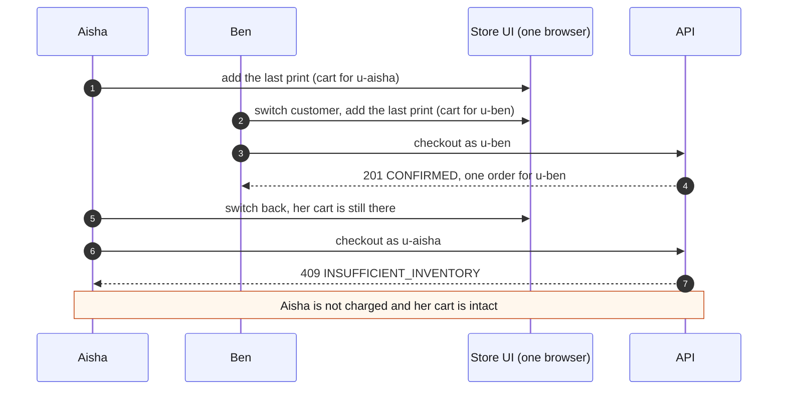
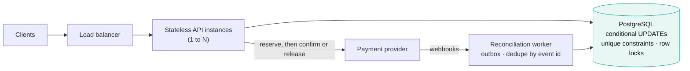

# Checkout & Rewards API: Architecture and Engineering Decisions

A Node.js, TypeScript, and Express API for an online store. The current demo uses an in-memory store and runs as a single instance.

**Store:** https://ublinox.vercel.app · **API:** https://ublinox-api.onrender.com

Related documents: [README](README.md) · [Error catalogue](docs/ERRORS.md) · [Edge cases](docs/EDGE_CASES.md) · [Test plan](docs/TEST_PLAN.md) · [Requirements checklist](docs/REQUIREMENTS.md)

---

## At a glance

| Area | Decision | Main trade-off |
|---|---|---|
| **Runtime and storage** | Single Node.js process; in-memory maps loaded from `data/products.json` | Simple to run and test, but data is lost on restart and multiple instances are unsafe |
| **Checkout consistency** | Validate while holding resource locks, await payment, then commit all state changes in one synchronous block | Avoids partial writes and refunds for failed checks, but locks are held during payment |
| **Concurrency** | FIFO keyed locks for carts, products, and coupons; deterministic lock order | Unrelated checkouts can proceed concurrently; popular products can queue |
| **Duplicate requests** | Required `Idempotency-Key`; successful responses replay for 24 hours; failed attempts release the key | Safe retries without permanently caching recoverable failures |
| **Inventory** | No reservation when adding to cart; stock is checked again during checkout | Carts can become stale, but abandoned carts do not hold stock |
| **Pricing** | Current checkout price, guarded by optional `expectedSubtotalCents`; order lines snapshot charged prices | Customers are asked to confirm visible price changes |
| **Money** | Integer cents; discount rounded half-up once and capped at subtotal | Exact, consistent arithmetic without floating-point money calculations |
| **Rewards** | Admin generates one coupon for each eligible order milestone | Simple milestone accounting; coupon generation is not idempotent |
| **Payment** | Asynchronous fake gateway behind a `PaymentGateway` interface | Makes races, declines, and timeouts testable; no real payment reconciliation |
| **Identity** | Demo `customerId` separates carts and order history | Demonstration only; it is not authentication or authorization |
| **Errors** | Consistent `{ error: { code, message, details } }` envelope | Clients can branch on stable error codes |
| **Scale-up path** | PostgreSQL, conditional updates, uniqueness constraints, and payment reconciliation | Required before multi-instance production deployment |

### System overview



---

## Contents

1. [System invariants](#1-system-invariants)
2. [Requirements and business rules](#2-requirements-and-business-rules)
3. [Material design decisions](#3-material-design-decisions)
4. [Transaction, concurrency, and idempotency strategy](#4-transaction-concurrency-and-idempotency-strategy)
5. [Locks](#5-locks)
6. [Input validation](#6-input-validation)
7. [Retries and idempotency](#7-retries-and-idempotency)
8. [Error model and descriptions](#8-error-model-and-descriptions)
9. [Edge cases](#9-edge-cases)
10. [Multiple customers: switching users to test concurrency](#10-multiple-customers-switching-users-to-test-concurrency)
11. [Testing](#11-testing)
12. [Implemented vs. deferred](#12-implemented-vs-deferred)
13. [Multiple instances and production scale](#13-multiple-instances-and-production-scale)
14. [How AI tools were used](#14-how-ai-tools-were-used)
15. [If I had more time](#15-if-i-had-more-time)

---

## 1. System invariants

These rules should hold even when requests overlap or fail.

| Area | Rule | How it is enforced |
|---|---|---|
| **Inventory** | Stock never goes below zero | Product locks and checkout-time stock checks |
| **Orders** | One cart creates at most one order | Cart state and idempotency checks |
| **Coupons** | A coupon can be redeemed once | Coupon lock and status check |
| **Failed checkout** | No order, stock, cart, or coupon changes are saved | State changes happen only after payment succeeds |
| **Rewards** | One coupon per completed-order milestone | Milestone count and generated-coupon count |
| **Money** | Totals stay non-negative and use whole cents | Integer-cent calculations and capped discounts |
| **Pricing** | Orders keep the prices charged at checkout | Price snapshots on order lines |
| **Reports** | Reports reflect saved data without changing it | Read-only report logic |
| **Customers** | Orders remain linked to the cart's customer | `customerId` is copied from cart to order |

---

## 2. Requirements and business rules

### 2.1 Business rules

| Topic | Decision |
|---|---|
| **Price changes** | Checkout uses current prices. If `expectedSubtotalCents` no longer matches, return `409 PRICE_CHANGED` and do not charge. |
| **Stock changes** | Adding to cart does not reserve stock. Availability is checked again at checkout. |
| **Order milestones** | Only completed orders count, once per checkout. Failed checkouts and retries do not count again. |
| **Coupon creation** | An admin request creates the next eligible milestone's coupon. |
| **Coupon use** | Anyone with the code can use it once. There is no expiry or minimum spend. |
| **Discount** | Applies to the full subtotal, rounds half up to the nearest cent, and cannot exceed the subtotal. |
| **Order status** | An order is created only after successful payment and is always `CONFIRMED`. A cart moves from `OPEN` to `CHECKED_OUT`. |
| **Reused key** | Reusing a key for a different cart or coupon returns `422 IDEMPOTENCY_KEY_REUSED`. |
| **Failed checkout** | The idempotency key is released so the customer can fix the issue and retry. |
| **Payment** | Uses an asynchronous fake gateway. |
| **Admin access** | Admin routes have no authentication in this demo. |
| **Customer identity** | `customerId` separates demo carts and order history; it is not authentication or access control. |

### 2.2 Pricing, rounding and the discount

All money is whole cents: `priceCents`, `subtotalCents`, `discountCents`, `totalCents`. The only place anything is rounded is the discount, once, in `domain/money.ts`.

Take 2 desk lamps at \$49.99 with a 10% coupon:

- line total: 4999 × 2 = 9998 cents
- subtotal: 9998
- discount: `floor((9998 × 10 + 50) / 100)` = 1000 (the `+ 50` is what makes halves round up)
- the discount is capped at the subtotal, so it stays 1000
- total: 9998 − 1000 = 8998, so the customer pays **\$89.98**

| Subtotal | Exact 10% | Discount | Total | What it shows |
|---|---|---|---|---|
| \$10.05 | 100.5¢ | 101¢ | \$9.04 | exactly half rounds up |
| \$10.04 | 100.4¢ | 100¢ | \$9.04 | below half rounds down |
| \$10.06 | 100.6¢ | 101¢ | \$9.05 | above half rounds up |
| \$0.05 | 0.5¢ | 1¢ | \$0.04 | smallest case |
| \$75.00 at 100% | 7500¢ | 7500¢ | \$0.00 | the cap, so never negative |

Money uses integer cents to avoid floating-point errors. Discounts are rounded half up once, keeping the calculation predictable and easy to explain.

In the report, gross revenue is the sum of subtotals, discounts is the sum of discounts, and net is gross minus discounts, which equals the sum of what was actually charged.

### 2.3 Coupons

- `n` and `x` come from `COUPON_EVERY_N_ORDERS` (default 5) and `COUPON_PERCENT_OFF` (default 10). The server refuses to start if they are not valid.
- Milestones reached = `floor(orders placed / n)`. Coupons owed = milestones reached − coupons generated.
- Admin `POST /admin/coupons` creates `SAVE10-AB12CD` style codes for the earliest owed milestone, or answers `409 NO_ELIGIBLE_MILESTONE` and says when the next one is.
- A customer sends `couponCode` at checkout. Case and spaces are ignored. It applies to the whole order.
- The coupon goes from `AVAILABLE` to `REDEEMED` in the same block that saves the order. If the checkout fails for any reason, the coupon stays available.



With `n = 5`: after 4 orders nothing is owed; after 5 one coupon is owed; once it is generated nothing is owed until order 10; if an admin waits until order 12, two coupons have been owed and each click creates the next one. The 5th order itself pays full price. The coupon is for a later order.

### 2.4 Status transitions

| Resource | Initial state | Successful action | Final state |
|---|---|---|---|
| **Cart** | `OPEN` | Checkout commits | `CHECKED_OUT` |
| **Order** | Does not exist | Payment succeeds and checkout commits | `CONFIRMED` |
| **Coupon** | `AVAILABLE` | Checkout using the coupon commits | `REDEEMED` |

A checked-out cart cannot be edited. Shipping, cancellation, and refunds are outside the scope of this demo.



### 2.5 If a rule has to change

- Change the milestone or discount settings in the environment and restart the server.
- To change rounding, update `percentOfCents` in `domain/money.ts`.
- To add coupon expiry or a minimum spend, update coupon generation and checkout validation, then document the related error.
- To count only orders above a threshold, update the order-counting logic in the commit block.
- One coupon per customer: store the customer on the coupon and compare it with the cart's customer in checkout.
- Reserving stock before payment would require changes to `checkoutService.ts` and the checkout flow.

---

## 3. Material design decisions

### Locks

#### Decision: An in-process lock per cart, product and coupon

**Context.** Node runs one piece of JavaScript at a time, so code without an `await` cannot be interleaved with another request. Checkout has to `await` the payment provider, and while it waits another request runs. Two checkouts can both see "1 in stock", both pay, and both commit.

**Options considered.**
1. One global lock around every checkout.
2. No locks. Decrement at the end and fail if stock would go negative.
3. Optimistic concurrency: version numbers and retry on conflict.
4. A lock per resource (cart, product, coupon).

**Choice.** Option 4. `domain/keyedMutex.ts` keeps a first-in-first-out queue per key (`cart:<id>`, `product:<id>`, `coupon:<code>`). Checkout holds the locks for its cart, products and coupon from validation until commit. Cart edits take the cart lock, and admin price or stock changes take the product lock. Section 5 has the details.

**Why.** A global lock is correct but a mug purchase would wait behind an unrelated lamp purchase. Option 2 only finds out about the conflict after payment, so the loser would need a refund. Option 3 makes sense with a database, but in memory it just adds retry loops. Per-key locks only make requests wait when they touch the same thing, and they serve them in the order they arrived.

**Consequences.** Unrelated checkouts run side by side. A slow payment holds its product's lock, so shoppers queue behind it, but the wait is capped (see [Bound every wait](#decision-bound-every-wait-lock-wait-timeout-payment-timeout-key-expiry)). The locks live in this process's memory, so they only work with one instance (see [In-memory store](#decision-in-memory-store-exactly-one-instance)).

#### Decision: Fixed lock order, cart first, then coupon and products sorted

**Context.** A checkout needs several locks. Two carts holding the same products in a different order could each take one lock and wait forever for the other.

**Options considered.** Take locks in cart order; take them with a timeout and retry; take them in one global order.

**Choice.** Lock the cart on its own first, because the list of products is only safe to read once the cart is locked. Then take the coupon and product locks together in one call that sorts the keys.

**Why.** With one global order a wait cycle cannot form, and no timeouts or retries are needed.

**Consequences.** A consistent lock order prevents deadlocks.

### Checkout flow

#### Decision: Check under the locks, then pay, then write everything in one step

**Context.** A checkout touches stock, the coupon, the order list, the cart and the order counter. If another request could see those halfway through, or something failed between two of them, the invariants above would break.

**Options considered.**
1. Pay first, then check and write.
2. Reserve stock, pay, then confirm or give it back.
3. Check everything under the locks, pay, then write everything in one synchronous block.

**Choice.** Option 3, in `services/checkoutService.ts`: checks, price, `await` payment, then one block with no `await` that lowers stock, redeems the coupon, saves the order, closes the cart, bumps the counter and stores the idempotency response.

**Why.** Option 1 charges customers who then lose the race. Option 2 needs a "give it back" path that must run exactly once, plus timers for abandoned reservations. With option 3 the losers are turned away before payment, so no refunds are needed. Once a payment is approved the write cannot fail, because everything was already checked and nothing else can run until it finishes.

**Consequences.** No partial writes and no refund path. Every error before the final block leaves the state untouched. The price is that locks are held while waiting for the payment.

### Idempotency

#### Decision: A required Idempotency-Key on checkout, released on failure

**Context.** Clients retry after timeouts. A retry must not create a second order or take stock twice.

**Options considered.**
1. Deduplicate by cart only, since a cart can become one order.
2. A client-supplied key that only remembers successes.
3. A key that remembers every response, failures included.

**Choice.** Option 2, plus the cart rule from option 1. Checkout needs an `Idempotency-Key` header (8 to 100 characters, letters, digits and `. _ : -`). Before the first `await` the key is claimed as in progress, together with a fingerprint of the cart id and the coupon. On success the 201 is stored and replayed with `Idempotent-Replayed: true`. On any failure the key is deleted.

**Why.** The cart rule alone cannot hand the original response back to a client that lost it. Remembering failures (option 3) would keep replaying "out of stock" even after the customer fixed the cart. Claiming the key synchronously means two identical requests cannot both get it. The character rule also rejects two headers that Node would merge into one `"a, b"` key.

**Consequences.** What every retry situation returns is in [Section 7](#7-retries-and-idempotency). Finished keys expire after 24 hours (see the next decision).

### Backpressure and timeouts

#### Decision: Bound every wait: lock-wait timeout, payment timeout, key expiry

**Context.** A load test (`scripts/load-test.ts`, 100 shoppers, 150 ms simulated payment) passed every invariant but showed checkout latency at p95 of about 6 seconds and roughly 8 orders per second. The reason is the decision above: a checkout holds its products' locks while it waits for payment, so shoppers for the same product are served one at a time. Per product that is about 1 divided by the payment time, and with a real provider at around a second it is one order per second for a popular item. That left three risks: the line behind a slow checkout had no limit, a provider that never answers would hold a product's lock forever, and finished idempotency keys were never removed.

**Options considered.**
1. Leave the waits unbounded.
2. Take stock in a synchronous block, release the product locks, pay, then confirm or give the stock back. That removes the queue.
3. Keep the design and put a limit on each wait.

**Choice.** Option 3.

| Protection | Setting | Behaviour |
|---|---|---|
| **Lock-wait timeout** | `LOCK_WAIT_MS` (default 10 s) | A request still waiting gives up with `503 SERVER_BUSY` and `Retry-After: 2`. Nothing is written, the customer is not charged, and the key is freed. |
| **Payment timeout** | `PAYMENT_TIMEOUT_MS` (default 15 s) | `504 PAYMENT_TIMEOUT`. Nothing is written and the locks and key are released. The key is passed on to the provider, so a real provider could recognise a retry. |
| **Key expiry** | `IDEMPOTENCY_TTL_MS` (default 24 h) | Finished keys are cleaned up lazily, at most once a minute. A late retry of an expired key still cannot duplicate, because the cart is already checked out and the answer is `409 CART_ALREADY_CHECKED_OUT` with the existing `orderId`. |

The browser retries `SERVER_BUSY` and `REQUEST_IN_PROGRESS` up to twice with the same key.

**Why.** Option 2 is the right production step, but it changes what shoppers see. While a payment is in flight its units are already held, so another shopper must wait even if the first payment later fails. It also needs a release step that runs exactly once, for stock and for the coupon. For a demo-sized service whose argument is easiest when nothing is written before payment succeeds, that was not worth it. Limiting the waits gives backpressure without touching that argument. With 250 shoppers and `LOCK_WAIT_MS=3000`, checkout p95 stayed at 3.0 s (max 3.3 s) instead of a growing queue, 175 requests were turned away with 503, there were no 5xx errors, and every invariant still held.

**Consequences.** Under a burst some shoppers get a 503 and have to retry. A popular product is still limited to about one order per payment time, and option 2 is what fixes that ([Section 15](#15-if-i-had-more-time)). After a 504 the real outcome is unknown with a real provider, so reconciliation is not built ([Section 12](#12-implemented-vs-deferred)). When a waiting request gives up, the next shopper can proceed; a timed-out request must not block the queue.

### Inventory and pricing

#### Decision: No stock reservation in the cart

**Context.** The brief says never oversell, and asks what happens when availability changes before checkout.

**Options considered.** Reserve stock when an item is added; reserve for a few minutes when checkout starts; reserve nothing and check at checkout.

**Choice.** Reserve nothing. `PUT` already refuses quantities above current stock, as early feedback, and checkout checks again under the lock.

**Why.** Reserving in carts lets abandoned carts hide stock from real buyers and needs expiry and release logic. Since we check before paying, checking at checkout is enough to never oversell, and the losers are not charged.

**Consequences.** Ten shoppers can each hold the last 3 units in their carts and only checkout decides. Someone can be refused at checkout after filling a cart. That is fine here, and a short reservation at checkout is the upgrade path.

#### Decision: Charge the price at checkout, guarded by expectedSubtotalCents

**Context.** An admin can change a price while a customer still has the old page open.

**Options considered.** Freeze the price when the item is added; always charge the current price silently; charge the current price but let the client say what it showed.

**Choice.** Orders use the price at checkout and keep it in the `OrderLine` snapshot. The client may send `expectedSubtotalCents`. If it differs from the current subtotal, up or down, checkout answers `409 PRICE_CHANGED` with both values and charges nothing. Admin price changes take the product lock, so they cannot land between validation and the final write.

**Why.** Freezing the price in the cart means honouring stale prices for as long as the cart exists. Silent repricing charges an amount the customer never saw. The assertion keeps the server in charge and still makes the change visible.

**Consequences.** The UI reloads the cart and asks the customer to confirm. API clients that leave the field out get the current price. Orders stay explainable after prices change.

### Money

#### Decision: Whole cents with one half-up rounding step

**Context.** Totals have to be exact and always come out the same. Floats drift.

**Options considered.** JavaScript numbers in dollars; a decimal library; whole cents.

**Choice.** Whole cents everywhere. The only rounding is the discount, `floor((subtotal × percent + 50) / 100)`, capped at the subtotal. [Section 2.2](#22-pricing-rounding-and-the-discount) has the rules and examples.

**Why.** Integer arithmetic is exact at these sizes and needs no extra dependency. One rounding point means one rule to explain and test.

**Consequences.** Every money field in the API ends in `Cents` and the UI does the formatting. A decimal type would only be needed for fractional cents, such as tax rates or currency conversion.

### Coupons

#### Decision: Admin creates one coupon per milestone, counted from completed orders

**Context.** "Every n-th successfully placed order makes one coupon available", generated when an administrator asks, at most once per milestone.

**Options considered.**
1. Apply the discount to the n-th order automatically.
2. Create the coupon automatically when the n-th order commits.
3. Let the admin generate the coupon for the earliest unrewarded milestone.

**Choice.** Option 3 (`services/couponService.ts`). Milestones reached = `floor(placedOrders / n)`, coupons owed = reached minus generated. One call creates one coupon or answers `409 NO_ELIGIBLE_MILESTONE`.

**Why.** The brief describes an administrator requesting generation, and option 1 contradicts "makes a coupon available". Generation has no `await`, so two admin calls at once cannot both create the coupon for the same milestone. Working out "owed" from counts gives "one per milestone" without extra bookkeeping.

**Consequences.** If the admin is late, several milestones can be owed and each call rewards the earliest. Someone could split one purchase into `n` small orders to unlock a coupon faster. Without accounts that is acceptable, and fixing it needs authentication.

### Persistence

#### Decision: In-memory store, exactly one instance

**Context.** The brief allows an in-memory store if the invariants still hold under overlapping requests, and asks how production would differ.

**Options considered.** SQLite; PostgreSQL; in-memory maps.

**Choice.** In-memory maps (`store.ts`), loaded from `data/products.json`. `render.yaml` pins the deployment to one instance.

**Why.** Reviewers need no setup or credentials, tests are fast and deterministic, and the concurrency problem stays visible in the code instead of being hidden inside a database. The tests show the invariants hold under real overlapping HTTP requests.

**Consequences.** A restart or redeploy wipes everything: orders, carts, coupons and idempotency keys. A retry after a restart therefore gets `404 CART_NOT_FOUND`, not a duplicate order. Two instances would each have their own stock and locks and could oversell. [Section 13](#13-multiple-instances-and-production-scale) covers the move to a database.

### Payment

#### Decision: A fake payment gateway that is asynchronous

**Context.** No real payment integration is needed, but the design has to cope with payment being slow or failing.

**Options considered.** Treat checkout as payment success with no payment step; a synchronous stub; an asynchronous fake behind an interface.

**Choice.** `domain/payment.ts` defines a `PaymentGateway` interface and a `FakePaymentGateway` that waits `PAYMENT_DELAY_MS` (150 ms by default), records every charge, and can be told to decline (`declineNext`) or never answer (`hangNext`).

**Why.** With no payment step there is no `await` in checkout, which hides the exact race the brief asks about. The asynchronous fake recreates the window in which other requests run, and it makes declines, timeouts and "who was charged" testable.

**Consequences.** A real provider can replace the fake behind the same interface. Webhooks, duplicate callbacks, reconciliation and refunds are not modelled.

### API

#### Decision: Demo customers are a declared id, each with their own cart and history

**Context.** Testing "many customers, one product" and showing order history per customer needs more than one shopper, but the brief says authentication is not required.

**Options considered.**
1. One anonymous shopper per browser, with history kept in `localStorage`.
2. Real accounts with login.
3. A `customerId` declared on the cart and copied to the order, with three demo customers to pick from in the UI.

**Choice.** Option 3. `POST /carts` takes an optional `customerId` (lower-case letters, digits and dashes, up to 40). The order copies it from the cart. `GET /orders?customerId=` returns that customer's orders with their items, newest first. The id is required there, so the endpoint cannot be used to list every order. The admin order list shows the customer. The UI keeps one open cart per customer and ignores a slow response that finishes after the user has switched. [Section 10](#10-multiple-customers-switching-users-to-test-concurrency) has the results.

**Why.** Option 1 ties history to one browser and cannot show two shoppers competing. Option 2 is a big feature the brief does not ask for. Option 3 is a few lines in the service, keeps history on the server, and makes the main scenarios easy to try by hand and by script.

**Consequences.** Nothing proves who a customer is, so anyone could read another customer's history by guessing the id. That is fine for a demo and it is listed under production steps ([Section 15](#15-if-i-had-more-time)). Carts and orders created without a customer have `customerId: null` and still work for API clients.

#### Decision: PUT sets the quantity, there is no "add one" endpoint

**Context.** Customers double-click "Add", and clients retry requests.

**Options considered.** A `POST` that increments; a `PUT /items/{productId}` with an absolute quantity.

**Choice.** `PUT /carts/{id}/items/{productId}` with `{ quantity: 1 to 99 }` adds the line or replaces its quantity. `DELETE` removes it.

**Why.** A retried "add one" adds twice, while a retried "set to 2" does no harm. So deliberate quick clicks are not lost, the UI disables "Add" until the previous update comes back.

**Consequences.** Cart edits are idempotent. The client has to know the current quantity, which it always has from the last cart response.

#### Decision: One error envelope with stable codes

**Context.** Errors need to be distinguishable and useful to an API client.

**Options considered.** An HTTP status plus free text; RFC 7807 problem details; a custom envelope with a stable code.

**Choice.** Every error is `{ error: { code, message, details } }`, with 24 codes in `domain/errors.ts`. [Section 8](#8-error-model-and-descriptions) lists them.

**Why.** Clients can branch on a stable `code`, and `details` carries what they need to act, such as how many are available or the existing `orderId`. It is simpler than RFC 7807 and carries the same information.

**Consequences.** Adding a failure means adding a code and documenting it in `docs/ERRORS.md`. A client mistake never turns into a 500 (an oversized body now gives 413 and a malformed URL gives 400; both returned 500 until the running server was probed for them).

---

## 4. Transaction, concurrency, and idempotency strategy

This is how the decisions above fit together on `POST /carts/{id}/checkout`:

1. Validate the header and body ([Section 6](#6-input-validation)).
2. Claim the `Idempotency-Key`. If it was used before, replay the stored answer or answer 409 or 422.
3. Lock the cart. Check that it is open and not empty.
4. Lock the coupon and the products, sorted. Check stock, the coupon, and the price the client expects.
5. `await` the payment, giving up after `PAYMENT_TIMEOUT_MS`.
6. Write everything in one block with no `await`, and store the response under the key.
7. In a `finally`: release the locks. If anything failed, delete the key. Nothing was written.

Which operations take which lock is in [Section 5](#5-locks). What a client does after each outcome is in [Section 7](#7-retries-and-idempotency).



Every red outcome writes nothing, releases the locks, and frees the key, so the customer can fix the problem and try again.

---

## 5. Locks

### Why Node needs locks at all

Node is single-threaded, but the payment `await` is a moment when other requests run while a checkout is half done. Two shoppers, one last print:

1. A takes the product lock for the print. B asks for it and waits.
2. A checks the stock (1) and goes ahead. A waits 150 ms for payment. B is still waiting.
3. A saves the order and the stock drops to 0. A releases the lock.
4. B gets the lock, sees stock 0, and gets `409 INSUFFICIENT_INVENTORY`. B was never charged.

Without the lock, B would also have seen stock 1 and the stock would end at -1.



### Lock ownership by operation

| Operation | Locks | What it protects |
|---|---|---|
| **Checkout** | the cart first, on its own; then the coupon and every product in the cart, sorted, in one call | nothing it validated can change before it saves |
| **Add, change or remove a cart item** | the cart | a cart cannot change while it is being paid for |
| **Admin price or stock edit** | the product | stock and price cannot change mid-checkout |
| **Generate a coupon** | none, there is no `await` in it | one coupon per milestone |
| **Reports, order lists, cart view, product list** | none, they only read and finish synchronously | they never see a half-finished order |

### Mutex behavior

`domain/keyedMutex.ts` keeps a queue of promises per key. A request runs once the one in front of it has released.

- Keys are sorted and de-duplicated before taking them, so two checkouts can never wait on each other.
- Waiting has a limit. After `LOCK_WAIT_MS` the request gets `503 SERVER_BUSY` with `Retry-After: 2`.
- A request that gave up still passes its place on when its turn arrives. Without that, one timeout would block everything behind it.
- If a request needs several keys and times out on the second, the first is released.
- Locks are released in a `finally`, on success and on every error, and a second release is ignored.
- Order is first in, first out per key. That comes from how the promise chain is built and no test asserts the order.

### Locking limitations

- The locks live in one process. Two instances would not see each other's locks, so scaling out needs the database approach in [Section 13](#13-multiple-instances-and-production-scale).
- Locks are held while waiting for payment, so one popular product handles about one order per payment time. Measured with a 150 ms payment, that was about 8 orders per second overall. [Section 15](#15-if-i-had-more-time) has the fix.
- Waiting is first in, first out per product, not per customer, so someone can wait behind many others.

---

## 6. Input validation

Every request goes through three checks before any business rule runs. Each one answers with a 4xx and writes nothing.

1. **Parse.** `express.json` with a 16 KB limit. A bad body gives `400 INVALID_JSON`, a big one `413 PAYLOAD_TOO_LARGE`, an unsupported type `415 UNSUPPORTED_MEDIA_TYPE`.
2. **Shape.** A zod schema per endpoint in `http/app.ts`, run by `parse`. Problems give `400 VALIDATION_ERROR`.
3. **Header.** The checkout key has to be 8 to 100 characters of letters, digits and `. _ : -`. Otherwise `400 IDEMPOTENCY_KEY_REQUIRED`.

What each input has to look like:

| Input | Rule |
|---|---|
| Item quantity | whole number from 1 to 99, nothing else in the body |
| `couponCode` | text, 1 to 40 characters after trimming; case and surrounding spaces are ignored |
| `expectedSubtotalCents` | whole number, 0 or more, optional |
| Admin `priceCents` and `inventory` | whole numbers, up to 100 000 000 and 1 000 000; at least one of them |
| `limit` and `offset` | 1 to 100 (default 20) and 0 or more (default 0) |
| `customerId` | lower-case letters, digits, dashes, 1 to 40; required to list a customer's orders |
| Ids in the path | not pattern-checked; an unknown id gives 404 |
| Server settings | `COUPON_*`, `LOCK_WAIT_MS`, `PAYMENT_TIMEOUT_MS`, `IDEMPOTENCY_TTL_MS` must be positive whole numbers or the server will not start |

A few things worth knowing:

- Every schema is strict, so an unknown field is a 400 and not silently ignored. A typo like `qty` cannot slip through.
- `VALIDATION_ERROR` lists every problem it finds, as `details.issues: [{ path, message }]`, so a form can highlight all of them at once.
- A body sent with the wrong content type counts as empty, so a required field is reported missing. A JSON array gives `VALIDATION_ERROR`, and a bare `null` or number gives `INVALID_JSON`.
- Input validation asks whether the request is well formed (a 400). State validation asks whether it is allowed right now (stock, cart status, coupon) and runs under the locks (a 409 or 422). I kept the two separate on purpose.
- The browser also limits quantities, but only to be helpful. The server never relies on it.

Probing the running server turned up two real gaps: a body over 16 KB and a malformed URL both returned 500. Both are fixed.

---

## 7. Retries and idempotency

### Who retries

- **The browser**, automatically, on a network error, `REQUEST_IN_PROGRESS` or `SERVER_BUSY`. Up to two more tries after 0.8 s and 1.6 s, always with the same key. Any other error is shown to the customer.
- **The customer**, after fixing a cart or after a decline. They check out again, and the same key is fine because a failure frees it.
- **An API client**, after any timeout. It sends the same request with the same key.

The UI also ignores clicks while a checkout is running, so a double-click sends one request.

### What happens to a key

It starts as nothing. When a checkout arrives the key is claimed as "in progress" (before the first `await`, together with a fingerprint of the cart and coupon). If the commit succeeds the 201 is stored under the key as "completed", and it is swept after 24 hours. If anything fails before the commit, the key is deleted.



### What a client should do after each outcome



### Idempotency outcomes

| Situation | Response | Why it is safe |
|---|---|---|
| Response lost, same key sent again | the stored 201 with `Idempotent-Replayed: true` | nothing runs a second time |
| Same key while the first request is still running | `409 REQUEST_IN_PROGRESS`; the browser waits and retries | only one request can claim the key |
| New key for a cart that already became an order | `409 CART_ALREADY_CHECKED_OUT` with the order id | a cart becomes one order |
| Same key for a different cart or coupon | `422 IDEMPOTENCY_KEY_REUSED` | the fingerprint differs |
| Out of stock, coupon used, or price changed | a 409; fix the cart and send again with the same key | the failure freed the key and wrote nothing |
| Payment declined | 402; send again with the same key | nothing was written |
| `503 SERVER_BUSY` | wait for `Retry-After`, send again with the same key | it never reached payment |
| `504 PAYMENT_TIMEOUT` | not retried automatically; check whether the provider charged | nothing is recorded here, and the key goes to the provider so it can recognise a retry |
| Key older than 24 hours | `409 CART_ALREADY_CHECKED_OUT` | the cart check still stops a second order |
| Server restarted | `404 CART_NOT_FOUND` | the carts are gone as well |
| Cart edit sent twice | same cart state | `PUT` sets the quantity, it does not add |

One call is not idempotent on purpose: `POST /admin/coupons`. Each call creates the next owed coupon, so repeating it after a lost response can create a second one if another milestone is owed. Two calls at once are safe. I left that as is.

---

## 8. Error model and descriptions

Every error has the same shape and clients should branch on `code`:

```json
{
  "error": {
    "code": "INSUFFICIENT_INVENTORY",
    "message": "Not enough stock for one or more items.",
    "details": { "lines": [{ "productId": "p-print", "requested": 4, "available": 3 }] }
  }
}
```

Statuses: 400 for a request that is malformed or invalid, 402 for a declined payment, 404 for something missing, 409 for a valid request that conflicts with the current state, 413 and 415 for a body that is too large or the wrong type, 422 for a request that is well formed but makes no sense, 503 when the server is busy, 504 when the payment provider is too slow, and 500 only for unexpected server errors.

| Code | HTTP | Meaning | `details` |
|---|---|---|---|
| `VALIDATION_ERROR` | 400 | a field is missing, the wrong type, out of range or unknown | `issues[]` |
| `INVALID_JSON` | 400 | the body is not valid JSON, or is `null` | none |
| `BAD_REQUEST` | 400 | malformed URL encoding | none |
| `IDEMPOTENCY_KEY_REQUIRED` | 400 | checkout without a valid key | none |
| `PAYMENT_DECLINED` | 402 | the provider declined; nothing charged or reserved | `reason` |
| `CART_NOT_FOUND` | 404 | no such cart | `cartId` |
| `PRODUCT_NOT_FOUND` | 404 | no such product | `productId` |
| `ITEM_NOT_IN_CART` | 404 | removing a product that is not in the cart | `productId` |
| `ORDER_NOT_FOUND` | 404 | no such order | `orderId` |
| `COUPON_NOT_FOUND` | 404 | no such coupon code | `code` |
| `ROUTE_NOT_FOUND` | 404 | unknown path or method | none |
| `INSUFFICIENT_INVENTORY` | 409 | more asked for than is in stock | `lines[]` with requested and available |
| `CART_ALREADY_CHECKED_OUT` | 409 | the cart is already an order | `cartId`, `orderId` |
| `COUPON_ALREADY_REDEEMED` | 409 | another order used the coupon | `code` |
| `PRICE_CHANGED` | 409 | the subtotal the client showed differs from the current one | old and new subtotal, lines |
| `REQUEST_IN_PROGRESS` | 409 | the same key is still being processed | none |
| `NO_ELIGIBLE_MILESTONE` | 409 | no unrewarded milestone has been reached | `placedOrders`, `nextMilestoneAtOrder` |
| `PAYLOAD_TOO_LARGE` | 413 | body over 16 KB | none |
| `UNSUPPORTED_MEDIA_TYPE` | 415 | the body type cannot be parsed | none |
| `CART_EMPTY` | 422 | checkout with no items | `cartId` |
| `IDEMPOTENCY_KEY_REUSED` | 422 | the key belongs to a different request | none |
| `SERVER_BUSY` | 503 | waited longer than `LOCK_WAIT_MS` for a lock | `resource` |
| `PAYMENT_TIMEOUT` | 504 | no answer within `PAYMENT_TIMEOUT_MS`; nothing recorded | none |
| `INTERNAL_ERROR` | 500 | unexpected error, logged | none |

The rules behind it:

- A client mistake never returns 500. A 5xx means a server problem or an overloaded server.
- A failed request writes nothing. Checkout reports the first failing check in a fixed order (the 12 steps are in `docs/ERRORS.md`).
- `message` is for people and can change. `code` and `details` are the contract.
- In the browser every error shows up as a toast reading `CODE: message`. `PRICE_CHANGED` is special: the cart reloads and the customer is asked to confirm. `SERVER_BUSY` and `REQUEST_IN_PROGRESS` are retried quietly.

---

## 9. Edge cases

| Situation | Expected behavior |
|---|---|
| **Duplicate checkout or retry** | Return the original successful order; do not charge or create another order. |
| **Two shoppers want the last item** | Only one checkout succeeds; the other is not charged. |
| **Multi-item cart has an item go out of stock** | Reject the whole checkout and leave state unchanged. |
| **Cart is empty or already checked out** | Reject checkout or further edits. |
| **Price changes before checkout** | Return `PRICE_CHANGED` so the customer can review the new total. |
| **Coupon is used twice** | Only the first successful checkout can redeem it. |
| **Payment fails or times out** | Do not commit order changes; release locks and the idempotency key as designed. |
| **Invalid request** | Return a suitable 4xx response instead of an unexpected server error. |
| **Several customers shop at once** | Keep carts and order histories separate; never oversell stock. |
| **Server restarts** | In-memory carts, orders, coupons, and keys are lost. |

Detailed scenarios are kept in [`docs/EDGE_CASES.md`](docs/EDGE_CASES.md).

---

## 10. Multiple customers: switching users to test concurrency

**The problem.** The app started with one anonymous shopper per browser. One person could not make two shoppers compete from the UI, so concurrency only showed up in scripts and tests, and order history could not be told apart per customer.

**What I added.** Three demo customers, chosen from a switcher in the header ("Shopping as..."): Aisha Khan (`u-aisha`), Ben Carter (`u-ben`) and Chloe Martin (`u-chloe`).

**How it works** (the decision is in [Section 3](#3-material-design-decisions)):

- `POST /carts` declares the `customerId`, the order copies it from the cart, `GET /orders?customerId=` returns that customer's history, and the admin order list shows who ordered.
- The browser keeps one open cart per customer and remembers who was selected across reloads.
- A response that arrives after the user has switched is ignored, so one customer's slow checkout cannot overwrite another customer's screen.
- This is not authentication. Nothing proves who a customer is.

**Result.** The browser keeps each customer's cart and history separate, restores the selected customer after reload, and does not let a slow checkout overwrite the screen after switching customers. Only one shopper can buy the last unit. This is a demo feature, not authentication.



**To try it yourself:** set the art print's stock to 1 in Admin, add it to Aisha's cart, switch to Ben and add it, check out as Ben, switch back to Aisha and check out.

---

## 11. Testing

Run these commands from the `backend` directory:

| Command | Purpose |
|---|---|
| `npm test` | Unit and API tests |
| `npm run edge-cases` | Checkout, concurrency, and failure scenarios |
| `USERS=100 npm run load` | Load test with 100 simulated shoppers |

The checks cover validation, checkout and payment failures, retries, coupon milestones, concurrent shoppers, order history, and money calculations. Browser checks cover customer switching and checkout on the deployed app.

**Known gaps:** no automated frontend tests, simulated payments, no multi-instance support, and burst-focused rather than long-running load tests. The hosting proxy may reject malformed URLs before the app sees them.

---

## 12. Implemented vs. deferred

| Area | Implemented | Not included yet |
|---|---|---|
| **Catalog** | Seeded products; admin can edit prices and stock | Create or deactivate products; cart expiry |
| **Cart and checkout** | Cart management, price checks, locks, idempotency, bounded waits, payment timeout | Stock reservation before payment |
| **Orders** | Confirmed orders, item-price snapshots, order lookup, admin list, customer history | Shipping, cancellation, refunds |
| **Customers** | Three demo customers with separate carts and history | Real accounts, authentication, authorization |
| **Coupons** | Milestones, admin generation, single use | Expiry, minimum spend, per-customer limits, idempotent generation |
| **Payments** | Async fake gateway that can decline or hang; charge log | Real provider, webhooks, reconciliation after timeout |
| **Pricing and reports** | Integer cents, discounts, totals, admin report | Tax and shipping calculations |
| **Storage** | In-memory store, one instance, 24-hour idempotency-key expiry | Persistent database and multi-instance deployment |
| **Frontend and deployment** | React store, customer switcher, admin page; API on Render and store on Vercel | Automated frontend tests and deploy-on-push |

---

## 13. Multiple instances and production scale

State and locks only work inside one process. With several instances the plan is:

| Today (one process) | Production |
|---|---|
| In-memory maps | PostgreSQL as the single source of truth |
| Product lock plus a stock check | `UPDATE products SET inventory = inventory - $q WHERE id = $id AND inventory >= $q`; no row updated means out of stock |
| Coupon lock plus a status check | `UPDATE coupons SET status = 'REDEEMED' WHERE code = $c AND status = 'AVAILABLE'` |
| Cart lock | `SELECT ... FOR UPDATE` on the cart row |
| Idempotency map | a table with a unique key, inserted first to claim it, cleaned up by age |
| Uniqueness in code | `UNIQUE(orders.cart_id)` and `UNIQUE(coupons.milestone)`, so the database rejects duplicates even if the code is wrong |
| Payment inside the locked section | two transactions: reserve stock and claim the coupon, then after the provider answers confirm or release in a compensating transaction. Never hold database locks during a network call. |
| Lost callbacks | an outbox table and a reconciliation job; webhooks deduplicated by the provider's event id |
| Declared `customerId` | real accounts, with carts and orders checked against the logged-in customer |
| Report computed on every read | a summary table or a read replica as volume grows |



I would do it in this order: the database and unique constraints, then the conditional updates, then the two-phase payment, then reconciliation. A distributed lock such as Redis is usually unnecessary once the conditional updates and constraints are in place.

---

## 14. How AI tools were used

Claude Code helped draft and implement much of the code, tests, diagrams, and documentation. I supplied the requirements, made the architecture decisions, reviewed the output, ran the app locally and in deployment, and checked the results.

The review caught a few issues: early designs were more complex than the brief required; some automated checks were not actually sending requests; one diagram used outdated error codes; malformed input exposed server errors; and the load script had a faulty stock reset. These were corrected before finalising the implementation.

The main decisions remain straightforward to explain: use in-process locks, validate before payment, commit changes together, bound waiting time, and keep the demo single-instance. The testing and production limitations are listed in Sections 11–13.

---

## 15. If I had more time

| Priority | Improvement | Why it matters |
|---|---|---|
| 1 | Reserve stock before payment, then confirm or release it exactly once | Improves throughput for popular products, but adds recovery logic. |
| 2 | Add a public `GET /rewards/progress` endpoint | Keeps customer-facing data separate from admin reporting. |
| 3 | Persist data in SQLite behind the existing service interface | Keeps carts and orders after a restart; a stepping stone toward PostgreSQL. |
| 4 | Reconcile payment timeouts with the provider | Resolves cases where a real payment may have succeeded despite a timeout. |
| 5 | Add authentication and per-customer coupon rules | Prevents customers from reading each other's history or using public admin routes. |

---

**Time spent:** 4 hours 30 minutes
