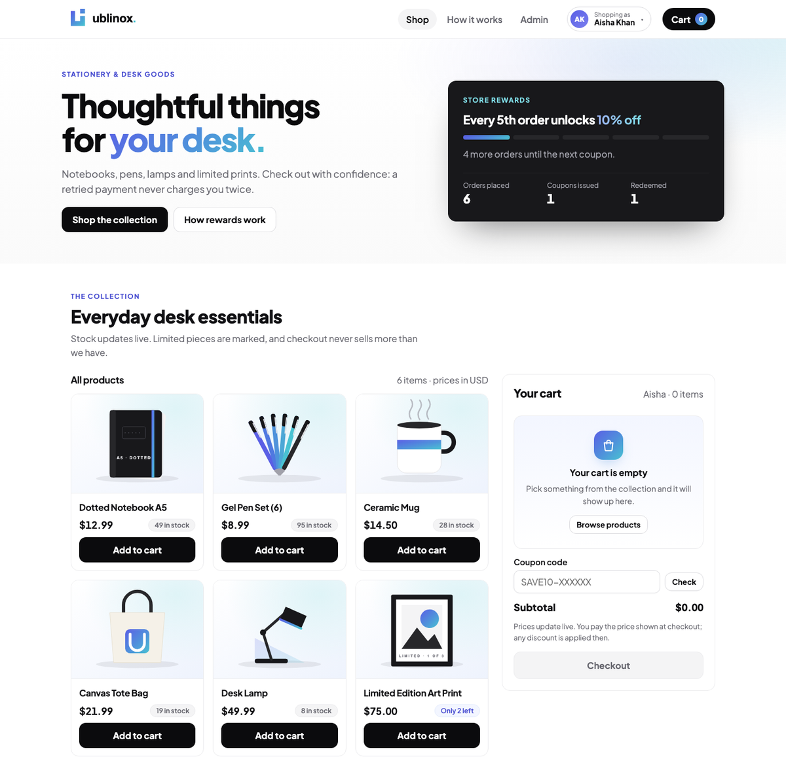
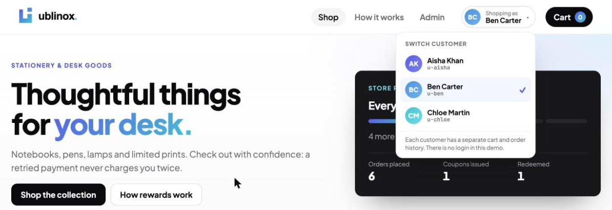
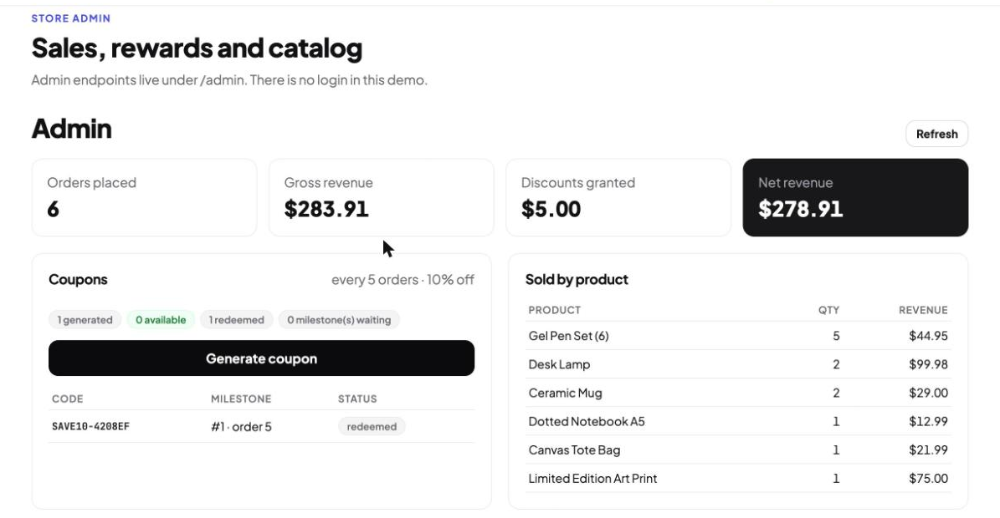
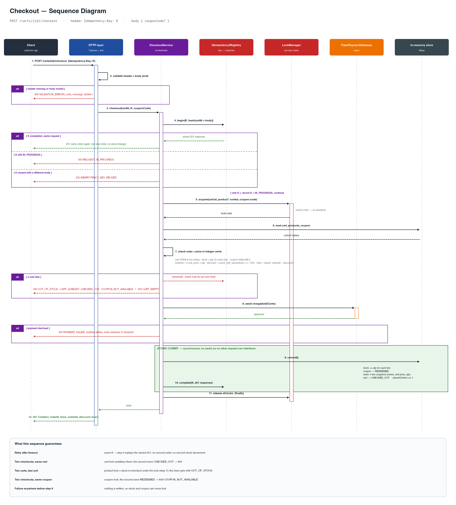

<div align="center">


# Ublinox Checkout & Rewards Service

**A small store backend that stays correct when requests are retried, repeated or arrive at the same moment.**

Carts · idempotent checkout · stock that never oversells · a coupon unlocked by every n-th order


[**Live store**](https://ublinox.vercel.app) · [**Live API**](https://ublinox-api.onrender.com/health) · [**Design decisions**](DECISIONS.md) · [**API reference**](#api-reference) · [**Quick start**](#quick-start)

</div>

---

## Contents

[Live demo](#live-demo) · [What it does](#what-it-does) · [Screenshots](#screenshots) · [How checkout works](#how-checkout-works) · [Quick start](#quick-start) · [Try the demo customers](#try-the-demo-customers) · [Configuration](#configuration) · [API reference](#api-reference) · [Project structure](#project-structure) · [Testing](#testing) · [Documentation](#documentation) · [Deployment](#deployment) · [Limits and next steps](#limits-and-next-steps)

## Live demo

| | URL | Hosted on |
|---|---|---|
| **Store** (React) | https://ublinox.vercel.app | Vercel |
| **API** (Node.js) | https://ublinox-api.onrender.com (try [`/health`](https://ublinox-api.onrender.com/health) or [`/products`](https://ublinox-api.onrender.com/products)) | Render, free plan, Singapore, one instance |

> [!NOTE]
> The API keeps everything in memory, so every restart or redeploy resets it to the starting data. The free plan also goes to sleep after about 15 minutes without traffic, so the first request after a break can take 30 to 60 seconds.

## What it does

- **Carts** with live prices, line totals and stock warnings. Setting a quantity replaces it, so a repeated request never adds twice.
- **Checkout that is safe to retry.** Send an `Idempotency-Key` and a repeated request returns the same order instead of creating another one.
- **Stock that never oversells.** Each cart, product and coupon has its own lock, and stock is checked before payment, so shoppers who lose a race are never charged.
- **A coupon for every n-th order.** An admin generates it, it can be used once, and a failed checkout never uses it up.
- **Exact money.** Whole cents everywhere, with the discount rounded half up and never above the subtotal.
- **Price-change guard.** If a price changed while the customer's page was open, checkout stops with `409 PRICE_CHANGED` instead of charging an amount they never saw.
- **Limits on waiting.** A shopper stuck in a long line gets `503 SERVER_BUSY`, and a payment provider that never answers gets `504 PAYMENT_TIMEOUT`. Neither leaves anything half-written.
- **Demo customers.** Three customers (Aisha, Ben, Chloe) with separate carts and order history, selectable in the header, so you can watch two shoppers compete for the last item.
- **Admin tools.** Sales report, coupon generation, order history with the customer, and price and stock edits.

## Screenshots

<p align="center">
  
</p>

<table>
  <tr>
    <td width="50%"></td>
    <td width="50%"></td>
  </tr>
  <tr>
    <td align="center"><sub>Switch between three demo customers, each with their own cart and history</sub></td>
    <td align="center"><sub>Admin: revenue, coupons, sales by product and the catalog</sub></td>
  </tr>
</table>

## How checkout works

```
Browser (React + Vite)
   │  JSON over HTTPS
   ▼
Express API ─ input validation (zod) ─ one error format
   │
   ▼
Services      cart · checkout · coupons · orders · report · products
   │
   ▼
Domain        money (cents) · errors · keyed locks · fake payment gateway
Store         in-memory maps, loaded from backend/src/data/products.json
```

`POST /carts/{id}/checkout` does this, in order:

1. **Validate** the header and body.
2. **Claim the Idempotency-Key.** If it was used before, replay the stored answer or refuse a different request.
3. **Lock the cart**, check it is open and not empty.
4. **Lock the coupon and products** (sorted, so two checkouts can never deadlock) and check stock, the coupon and the price the client expects.
5. **Wait for payment**, with a time limit.
6. **Write everything in one step** with no waiting in between: lower the stock, redeem the coupon, save the order, close the cart.
7. **Release the locks.** If anything failed, nothing was written and the key is freed so the customer can fix the cart and try again.

<details>
<summary>Sequence diagram of the whole flow</summary>



</details>

## Quick start

You need **Node.js 20 or later**.

```bash
git clone https://github.com/rahuljhas/ublinox.git
cd ublinox

# Terminal 1: the API on http://localhost:3000
cd backend
npm install
npm start

# Terminal 2: the store on http://localhost:5173 (it forwards /api to the API)
cd frontend
npm install
npm run dev
```

Open http://localhost:5173. The data is in memory, so a restart puts everything back to the six starting products.

A quick check from the command line:

```bash
CART=$(curl -s -X POST localhost:3000/carts \
  -H 'Content-Type: application/json' \
  -d '{"customerId":"u-aisha"}' | jq -r .id)

curl -s -X PUT localhost:3000/carts/$CART/items/p-lamp \
  -H 'Content-Type: application/json' \
  -d '{"quantity":2}'

curl -s -X POST localhost:3000/carts/$CART/checkout \
  -H 'Idempotency-Key: demo-key-0001' \
  -H 'Content-Type: application/json' \
  -d '{}'

# Send that last request again: you get the same order back,
# with the header Idempotent-Replayed: true
```

## Try the demo customers

There is no login. The header has a switcher with three customers, and each one has their own cart and order history.

| Customer | Id |
|---|---|
| Aisha Khan | `u-aisha` |
| Ben Carter | `u-ben` |
| Chloe Martin | `u-chloe` |

To watch two shoppers compete for the last item:

1. Open **Admin → Catalog** and set the *Limited Edition Art Print* stock to `1`.
2. As Aisha, add the print to the cart. Switch to Ben and add it there too.
3. Check out as Ben: the order goes through.
4. Switch back to Aisha. Her cart says "only 0 left", and checking out gives `INSUFFICIENT_INVENTORY`. She is not charged and her cart is untouched.

## Configuration

Environment variables for the API. Every one is optional.

| Variable | Default | What it does |
|---|---|---|
| `PORT` | `3000` | HTTP port |
| `COUPON_EVERY_N_ORDERS` | `5` | Every n-th placed order unlocks one coupon |
| `COUPON_PERCENT_OFF` | `10` | Coupon discount in whole percent (1 to 100) |
| `PAYMENT_DELAY_MS` | `150` | How long the fake payment provider takes |
| `LOCK_WAIT_MS` | `10000` | Longest a request waits for a cart, product or coupon before `503 SERVER_BUSY` |
| `PAYMENT_TIMEOUT_MS` | `15000` | Longest checkout waits for payment before `504 PAYMENT_TIMEOUT` |
| `IDEMPOTENCY_TTL_MS` | `86400000` | How long a finished Idempotency-Key is remembered (24 hours) |

The API refuses to start if a value is not valid. For example, `COUPON_EVERY_N_ORDERS=3 COUPON_PERCENT_OFF=20 npm start` gives a 20% coupon on every 3rd order.

For the frontend, `VITE_API_URL` points the built site at a deployed API. In development the Vite server forwards `/api` to `http://localhost:3000` (set `API_URL` to change that).

## API reference

All bodies are JSON and all money is in whole cents (`priceCents`, `totalCents`, and so on). The full error list is in [`docs/ERRORS.md`](docs/ERRORS.md).

### Errors

Every error has the same shape, and `code` is stable, so clients should branch on it:

```json
{
  "error": {
    "code": "INSUFFICIENT_INVENTORY",
    "message": "Not enough stock for one or more items.",
    "details": { "lines": [{ "productId": "p-print", "requested": 2, "available": 1 }] }
  }
}
```

### Customer endpoints

| Endpoint | Body | Success | Main errors |
|---|---|---|---|
| `GET /health` | | 200 `{ "status": "ok" }` | |
| `GET /products` | | 200 list of products | |
| `POST /carts` | `{ "customerId"?: string }` | 201 cart | 400 `VALIDATION_ERROR` |
| `GET /carts/{cartId}` | | 200 cart with current prices, totals and stock warnings | 404 `CART_NOT_FOUND` |
| `PUT /carts/{cartId}/items/{productId}` | `{ "quantity": 1 to 99 }` | 200 cart (adds the item or sets its quantity) | 400, 404 `PRODUCT_NOT_FOUND`, 409 `INSUFFICIENT_INVENTORY`, 409 `CART_ALREADY_CHECKED_OUT` |
| `DELETE /carts/{cartId}/items/{productId}` | | 200 cart | 404 `ITEM_NOT_IN_CART`, 409 `CART_ALREADY_CHECKED_OUT` |
| `POST /carts/{cartId}/checkout` | `{ "couponCode"?: string, "expectedSubtotalCents"?: int }` plus header `Idempotency-Key` (8 to 100 characters) | 201 order. A repeat with the same key returns the same order with `Idempotent-Replayed: true` | 400, 402 `PAYMENT_DECLINED`, 404, 409 (stock, cart, coupon, `PRICE_CHANGED`, `REQUEST_IN_PROGRESS`), 422 `CART_EMPTY` / `IDEMPOTENCY_KEY_REUSED`, 503 `SERVER_BUSY`, 504 `PAYMENT_TIMEOUT` |
| `GET /orders/{orderId}` | | 200 order with its lines (name, unit price, quantity), subtotal, discount and total | 404 `ORDER_NOT_FOUND` |
| `GET /orders?customerId=&limit=&offset=` | | 200 `{ orders, total, limit, offset }`: that customer's orders, newest first | 400 (customerId is required) |
| `GET /coupons/{code}` | | 200 `{ code, percentOff, status }` | 404 `COUPON_NOT_FOUND` |

### Admin endpoints

There is no authentication in this demo. Everything under `/admin` is an admin operation.

| Endpoint | Body | Success | Main errors |
|---|---|---|---|
| `POST /admin/coupons` | | 201 coupon for the earliest unrewarded milestone | 409 `NO_ELIGIBLE_MILESTONE` (says when the next one is) |
| `GET /admin/coupons` | | 200 all coupons with their status | |
| `GET /admin/orders?limit=&offset=` | | 200 `{ orders, total, limit, offset }`, newest first (limit 1 to 100, default 20) | 400 |
| `GET /admin/report` | | 200 orders placed, quantity sold per product, gross revenue, discounts, net revenue, coupons generated / available / redeemed | |
| `PATCH /admin/products/{productId}` | `{ "priceCents"?: int, "inventory"?: int }` | 200 product | 400, 404 `PRODUCT_NOT_FOUND` |

## Project structure

```
.
├── backend/
│   ├── src/
│   │   ├── server.ts, context.ts       start-up and configuration
│   │   ├── store.ts                    all data, in memory
│   │   ├── data/products.json          the six starting products
│   │   ├── http/app.ts                 routes, input validation, error handling
│   │   ├── services/                   cart, checkout, coupons, orders, report, products
│   │   └── domain/                     types, errors, money, keyed locks, fake payment
│   ├── test/                           140 automated tests
│   └── scripts/                        live edge-case checks and the load test
├── frontend/
│   ├── src/                            React app: shop, cart, customer switcher, admin
│   └── public/                         logo and product pictures
├── docs/                               requirements, edge cases, errors, test plan, diagrams
├── DECISIONS.md                        design decisions and trade-offs
├── render.yaml                         API deployment settings
└── task.md                             the assignment brief
```

## Testing

```bash
cd backend
npm test                       # 140 automated tests, a few seconds
npm run typecheck              # TypeScript, no output files

# These two need the API running (npm start in another terminal):
npm run edge-cases             # 37 black-box checks over HTTP
USERS=100 npm run load         # many shoppers at once, then checks every invariant
```

| What | Size | What it proves |
|---|---|---|
| Automated tests | 140 | Every endpoint with bad input, races and retries, coupons, money, per-customer history, timeouts, and 60 random overlapping operations that must leave every invariant true |
| Live edge-case checks | 37 | The same behaviour against any running server, including the deployed one |
| Load test | 4 phases | A race for the last stock, mixed shoppers while an admin changes prices, double-clicks and a coupon race. It checks stock, orders, revenue and coupon counts afterwards |

The tests also have to catch real bugs: with the locks switched off, the race tests fail, and removing each timeout fails its own test. Each test starts its own real HTTP server with fresh data, so concurrent requests genuinely overlap.

On a laptop, 100 shoppers placed 81 orders with no server errors and every invariant held. The checks against the deployed API pass 36 of 37; the one miss is a malformed-URL check that Render's own proxy answers with a `520` before the app sees it.

> [!WARNING]
> `npm run load` and `npm run edge-cases` create orders and change stock on the server they point at. Restart the API afterwards to reset it.

## Documentation

| Document | What is in it |
|---|---|
| [`DECISIONS.md`](DECISIONS.md) | The design decisions, the alternatives that were rejected, locks, retries, rounding, testing, what was left out, and how AI tools were used |
| [`docs/REQUIREMENTS.md`](docs/REQUIREMENTS.md) | Every requirement in the brief, mapped to the code and the test that proves it |
| [`docs/EDGE_CASES.md`](docs/EDGE_CASES.md) | Each edge case from the assignment and what happens |
| [`docs/ERRORS.md`](docs/ERRORS.md) | All 24 error codes, when they happen, and what a client should do |
| [`docs/TEST_PLAN.md`](docs/TEST_PLAN.md) | The test cases by endpoint, with the invariants they protect |
| [`docs/index.html`](docs/index.html) | A single-page summary of the requirements (open it in a browser) |
| [`docs/checkout-sequence.png`](docs/checkout-sequence.png) | Sequence diagram of checkout |
| [`task.md`](task.md) | The original assignment brief |

## Deployment

| Part | Host | Settings |
|---|---|---|
| API | Render web service `ublinox-api`, free plan, Singapore | One instance, health check `/health`, see `render.yaml` |
| Store | Vercel project `ublinox` | `VITE_API_URL` points at the API |

Neither service deploys when you push to GitHub, so a deploy is a command:

```bash
# API
render deploys create srv-dbasmass728c739hftlg --commit <sha> --wait
# Store
cd frontend && vercel deploy --prod
# Reset the API's in-memory data
render restart srv-dbasmass728c739hftlg --confirm
```

## Limits and next steps

- **One instance only.** State and locks live in one process. A second instance would have its own stock and could oversell. The way to scale out (a database with conditional updates and unique constraints) is in [`DECISIONS.md`](DECISIONS.md), section 13.
- **A popular product serves about one order per payment time**, because its lock is held while payment runs. The waiting is capped, but lifting the limit needs a reservation step (section 15).
- **No login.** Customer ids are declared by the browser, and the admin routes are open.
- **The payment provider is a fake.** Webhooks, reconciliation after a timeout and refunds are not built.

---

<div align="center">

Built for the take-home brief in [`task.md`](task.md). Claude Code helped write much of it, and [`DECISIONS.md`](DECISIONS.md) section 14 says what was done by the AI and what was decided and checked by hand.

</div>
